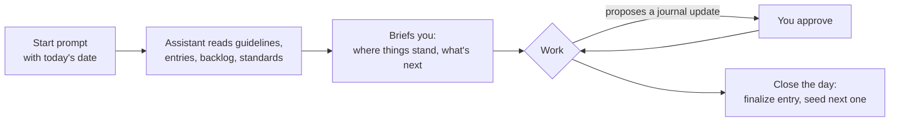
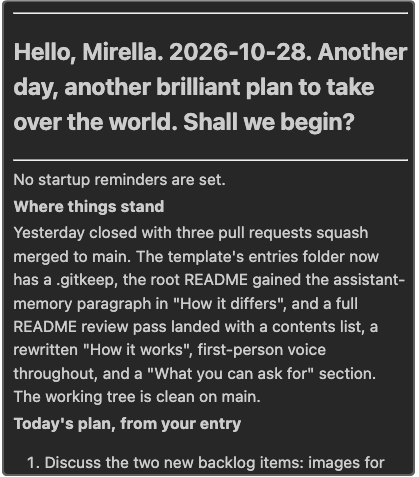

# What is a dev journal?

This is a shared record for a developer and their AI coding assistant, to be used in a project folder with tools similar to Claude Code. Imagine both you and the AI coding assistant writing to the same notebook, reading each other's notes, and reminding each other of where you left off and why you did what you did. It's a cozy partnership, and true peer development.

A dev journal keeps the context, decisions, guardrails, and to-do list of a project in one place that both of you read and write. No chat session starts from zero; the human keeps as much control over every change as they want, and a refresher is one ask away.

The journal is tool-agnostic because what is being shared is a working practice, not an integration. I've tested with Claude Code and IBM Bob, and it should work with any AI coding assistant that can read and edit files in your project.

## TL;DR: how it works

A dev journal is a directory containing instructions, journal entries and even recipes for tasks a developer wants to have handy. It is a collection of Markdown files that live inside your project structure so your AI coding assistant can find it. If you use a remote repository, you decide whether it stays on your machine or is pushed to the repo with your code.

At the start of every chat session, I paste one prompt that gives my AI coding assistant today's date and points it at the guidelines. The guidelines are my rules of engagement: the guardrails the assistant works within, and mine to change. The assistant reads the guidelines, the latest journal entries, the backlog, and the standards, then briefs me: where things stand, what was in progress, and what's next. Through the session it proposes journal updates as we go: tasks moved from the backlog to the day's entry, decisions recorded with their reasoning, blockers noted. I approve each one. At the end of the day it closes the entry and seeds the next one.



You can read more about the intent behind this idea in the next few sections, or jump straight to [Getting started](#getting-started). I hope you have fun with this idea and feel free to drop me a note and let me know how this works for you!

- Connect on [LinkedIn](https://www.linkedin.com/in/mirella-batista/)
- Follow on [Instagram](https://www.instagram.com/mirella4real)
- Visit [mirellabatista.com](https://www.mirellabatista.com)

---

## Contents

- [Who it's for](#who-its-for)
- [Why use it](#why-use-it)
- [How it works](#how-it-works)
  - [A session, step by step](#a-session-step-by-step)
  - [What you can ask for](#what-you-can-ask-for)
  - [Keeping the human in the process](#keeping-the-human-in-the-process)
- [How it differs from CLAUDE.md, assistant memory, or a notes file](#how-it-differs-from-claudemd-assistant-memory-or-a-notes-file)
- [Getting started](#getting-started)
  - [What's in the template](#whats-in-the-template)
  - [Set it up](#set-it-up)
- [Using it in a team](#using-it-in-a-team)
- [The origin story](#the-origin-story)
- [Repository layout](#repository-layout)
- [Status](#status)
- [License](#license)

---

## Who it's for

Any developer who works with an AI coding assistant. The journal is deliberately generic and adaptable:

- A solo developer tired of providing context at the start of every chat.
- A developer who wants to capture their reasoning and decisions in a journal that they, their assistant, or other developers can refer back to.
- A team that wants a consistent, reviewable record of AI-assisted work.
- A hobbyist who can't code every day and needs a refresher on where the project stands before each session.

## Why use it

Reasons developers adopt a dev journal. This list grows as I hear from people using it.

- **Context switching without losing your place.** Move between two or more projects and pick up each one exactly where you left it. The journal records where things stand, what was in progress, and what's next, so the cost of switching drops to one start prompt.
- **Stop re-explaining your project to every new chat.** Each session begins with the assistant reading the journal and briefing you. You don't rebuild context by hand when a chat runs out of memory or a new day starts.
- **Keep your reasoning, not just your code.** Decisions are recorded as they're made, with the alternatives considered and why they were rejected. You, your assistant, or another developer can look up why something is the way it is months later.
- **Hand work off cleanly.** When someone else picks up a project, the journal tells them where to start: open tasks, recent decisions, and known blockers. No archaeology through commit history or chat logs.
- **Keep the human in the process.** The assistant proposes; you approve. Every journal update, file change, and git command goes through you. The journal makes that protocol explicit instead of hoping the assistant behaves.

## How it works

The TL;DR above is the whole loop. This section walks through it: what a session looks like, what you can ask for along the way, and how the journal keeps you in control.

### A session, step by step

1. **Start.** Paste the start prompt with today's date. The assistant reads `SESSION_GUIDELINES.md`, today's entry and the previous one, the backlog, and the standards, and confirms each file it read.
2. **Briefing.** It greets you and briefs you: where things stand, what was in progress, and what's next on the backlog.
3. **Work.** As you work, it proposes journal updates: a task moved from the backlog to Completed Today, a decision recorded with the alternatives and why they were rejected, a blocker noted. Each one waits for your approval.
4. **Close the day.** When you ask, it finalizes today's entry, checks the backlog holds only open items, and seeds the next entry with the plan you give it.

Here is what step 2 looks like in Claude Code:



If a chat runs out of memory mid-day, open a new one and paste the start prompt again. The assistant picks up from the journal.

### What you can ask for

Once a session is running, the journal is kept through plain requests. The assistant proposes the exact change and waits for your yes. Some examples:

- **Record a decision.** "Record that as a decision: we chose SQLite over Postgres because this runs on one machine." The assistant drafts a Decisions & Rationale entry with the alternatives and why they were rejected.
- **Add a task.** "Add to the backlog: write the export script, target Friday." It goes into `RUNNING_TODO.md` with the target date.
- **Mark a task done.** "The export script is done." It moves to Completed Today in the day's entry and comes off the backlog.
- **Note a blocker.** "Add a blocker: waiting on the API key from ops." It goes under Blockers & Open Questions.
- **Save a recipe.** "Save how we did that as a recipe." The assistant proposes a name and scope, then writes it to `recipes/` and adds it to the index.
- **Get your bearings.** "Where did we leave off?" or "What's next?" The assistant answers from the journal, not from memory.
- **Close the day.** "Let's close the day." The assistant finalizes today's entry, checks the backlog holds only open items, and seeds the next entry with the plan you give it.

### Keeping the human in the process

I designed the journal around one idea: the assistant proposes, the developer decides. That isn't a brake on productivity. It's how you stay the person who understands and is accountable for the work.

It's fine, and encouraged, to ask your AI coding assistant to slow down:

- **Work through things step by step.** Ask for one change at a time instead of a finished batch. You see each move and can stop or redirect before the next one.
- **Explain, don't just conclude.** Ask why this approach, what the alternatives were, and why they were rejected. If the reasoning doesn't hold up, you've caught it before it's in your code.
- **Ask clarifying questions.** If you don't follow something, say so. A good assistant restates it differently rather than pressing on.
- **Challenge the approach.** Push back when something feels wrong, conflicts with your standards, or contradicts a decision you already made. Expect the assistant to push back too, and to point at the earlier decision instead of re-arguing it.
- **Approve every change.** Journal updates, file edits, and git commands all wait for your yes. Nothing happens because the assistant assumed.

These expectations aren't just advice. The template's `SESSION_GUIDELINES.md` has a "Working with the developer" section that turns them into rules the assistant reads at the start of every session: present the intent before acting, explain reasoning and name alternatives, flag conflicts with the standards, leave git commands to you. That section is yours to edit. If something here resonates, add it there and it travels with every chat. Some examples:

- "Before a change with more than one step, list the steps and wait for my go-ahead on each."
- "When I ask a question, answer it. Don't start editing until I ask for a change."
- "When you're unsure, say so and tell me what would settle it."
- "When I challenge an approach, engage with the objection. Don't just switch to what I said."
- "When you explain something, use plain language and one concrete example."

The journal entries then capture the reasoning, so the decisions you worked through together are still there when you need them.

## How it differs from CLAUDE.md, assistant memory, or a notes file

**CLAUDE.md** (and its equivalents in other tools) tells the assistant how to behave. It is static instructions, specific to one tool, and it records nothing about what happened. A dev journal is a dated, living record of what was done, what was decided, and what's still open. It is tool-agnostic, and both the developer and the assistant read and write it. The two complement each other: CLAUDE.md can point at the journal.

**An assistant's own memory** (Claude Code's memory directory, or its equivalent elsewhere) persists across sessions, but it belongs to the tool, not the project. The assistant writes it on its own judgment, it lives outside your repository, and it is gone when you switch tools. A dev journal is written with your approval, lives with the code, and works with any assistant. The two can coexist: the journal is the record, memory is the assistant's private notes about how to work with you.

**A notes file** has no structure and no protocol. A dev journal has both:

- A startup procedure the assistant follows every session: read the journal, confirm what was read, brief the developer.
- A defined lifecycle for tasks: from the backlog, to a day's completed list, never lost between the two.
- An approval rule for every change, which is what enforces human-in-the-loop rather than just encouraging it.
- An optional standards document (the constitution) the assistant is held to, which the developer can adapt.

## Getting started

### What's in the template

| File | Purpose |
|---|---|
| `SESSION_GUIDELINES.md` | The assistant's governing instructions: how to start a session, update the journal, and work with the developer |
| `README.md` | Developer's guide to the journal and the session start prompt |
| `RUNNING_TODO.md` | The backlog: single source of truth for open tasks |
| `entries/YYYY-MM-DD.md` | One entry per working day: plan, completed work, what was done, decisions, blockers |
| `recipes/` | Things worth remembering how to do: repeatable tasks, procedures with pitfalls, and prompts worth reusing. Freeform Markdown with an index |
| `templates/` | Template for new daily entries |
| `constitution.md` | A slimmed-down set of development standards the assistant follows. Adapt it to your preferences and needs |
| `constitution-enterprise.md` | An example of an enterprise-level constitution, for teams that need stronger controls |

### Set it up

1. Copy `dev-journal-template/` into your project and rename it `dev-journal/`. The suggested location is `.local-docs/dev-journal/`.
2. Add `.local-docs/` to your `.gitignore` if you want the journal private to your machine. See [Using it in a team](#using-it-in-a-team) for the team option.
3. Read through `SESSION_GUIDELINES.md` and enter your project information under Journal Settings. Once done, set Initialized to true. If you skip this, the assistant will walk you through the setup in your first session. Feel free to change `SESSION_GUIDELINES.md` to make it your own.
4. Decide whether you want to adopt a constitution. `constitution.md` is provided as a starter document. Edit it to make it your own. A second constitution (`constitution-enterprise.md`) is provided as a reference in case you want enterprise-level guidance for your project. If you use GitHub's [Spec Kit](https://github.com/github/spec-kit), point the Standards files entry in Journal Settings at your existing constitution and delete the provided ones.
5. Start a chat with your assistant and paste the start prompt, replacing the date. You can change the prompt in `SESSION_GUIDELINES.md`. The date is in the prompt on purpose. Assistants don't reliably know what day it is, so you tell them.

   ```
   Today is YYYY-MM-DD. Please read SESSION_GUIDELINES in .local-docs/dev-journal to start today's session.
   ```

## Using it in a team

If a team wants to commit their journals, treat them as documentation as code: keep them in the repository in a `dev-journals/` directory with one folder per developer, for example `dev-journals/<developer-name>/`, and change them through the same branches and pull requests as everything else. A teammate picking up someone else's work then has a quick reference for where to start: that developer's latest entry, open backlog, and decisions.

## The origin story

I came up with this idea while working on my own projects, after watching where AI coding tools were heading: more autonomy, longer unattended runs, fewer moments where a person has to say yes. The output gets faster and the developer understands less of it. Two weeks later nobody can explain why the code looks the way it does.

I wanted the opposite. Not a brake on the assistant, but a way of working where I could stay in the process (and quite frankly, dictate the speed): present at each step, making the decisions, and able to hand the work to a future self or a teammate without archaeology. The instruction files that tools offer, such as CLAUDE.md, tell the assistant how to behave. Nothing held the state of the work itself: what was decided, what was rejected and why, what is half done.

I am sharing this idea so other developers can use it, adapt it and improve on it, as we work out how to use AI while keeping the human in the process, guiding it.

Mirella Batista, October 2026

## Repository layout

```
dev-journal/
├── README.md                 this file
├── dev-journal-template/     the published template; copy this into your project
├── docs/images/              screenshots used in this README
└── .local-docs/dev-journal/  this repo's own journal, gitignored (I use the template to build it)
```

## Status

Early and in active use. The template carries a version comment in `SESSION_GUIDELINES.md` (currently 0.1.0). Expect the structure to change while it's being fine-tuned.

## License

MIT. See [LICENSE](LICENSE).
